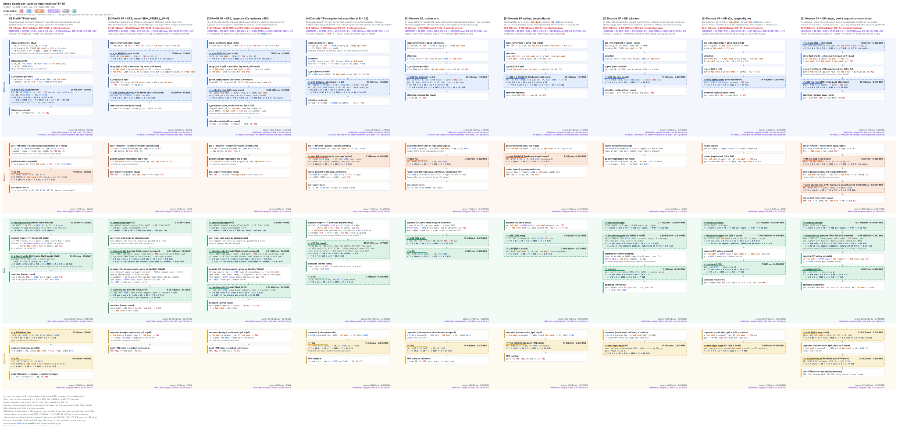
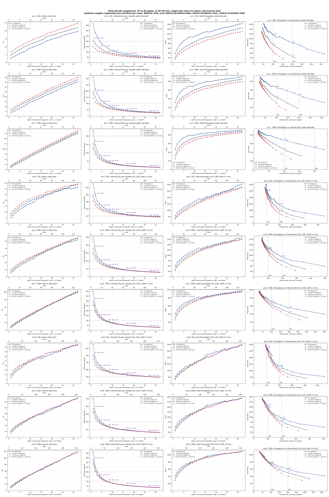
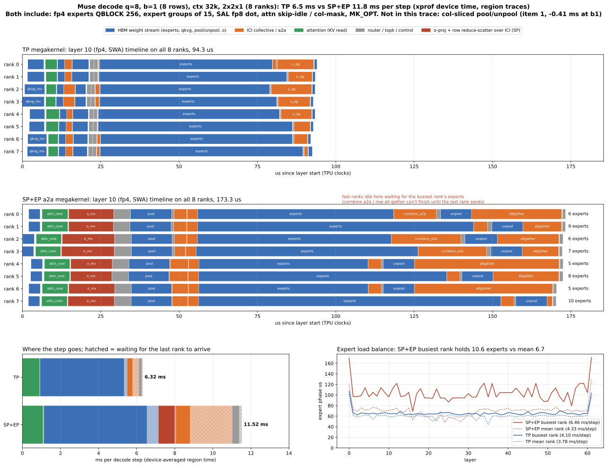
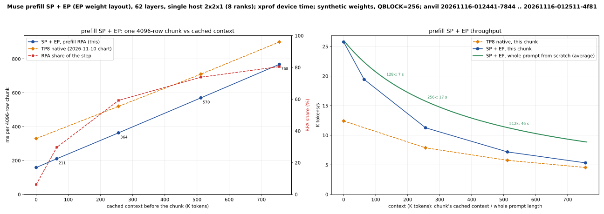
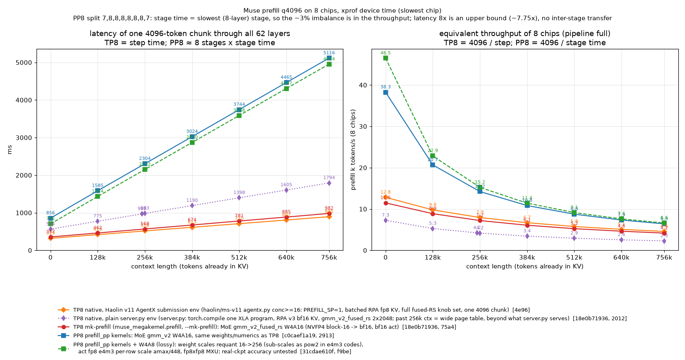

# Muse megakernel communication

Per-layer communication of Muse Spark at TP 8 for the two prefill programs (TP / SP) and the decode megakernel. The diagrams are generated by [gen_diagrams.py](gen_diagrams.py); when the kernels change, update the data there and rerun:

```bash
python sglang_tpu/muse_megakernel/doc/gen_diagrams.py
```



Single-column views: [(1) Prefill TP](comm_prefill_tp.svg) · [(2) Prefill SP](comm_prefill_sp.svg) · [(3) Prefill SP target](comm_prefill_sp_target.svg) · [(4) Decode TP](comm_decode_tp.svg) · [(5) Decode EP](comm_decode_ep_gather.svg) · [(6) EP target](comm_decode_ep_gather_target.svg) · [(7) Decode SP + EP](comm_decode_ep_a2a.svg) · [(8) SP + EP target](comm_decode_ep_a2a_target.svg) · [(9) SP + EP target, sliced pool / unpool](comm_decode_ep_a2a_sliced.svg)

Columns (1), (2), (4), (5) and (7) show the code as it is ((2) is uncommitted wave 1; (5) and (7) exist but are not wired for serving). (6) and (8) sit next to (5) and (7) and show them under the dtype policy below; (3) is (2) with the o RS replaced by a row all-to-all (approved, not implemented). (9) is (8) with pool / unpool on column slices of the replicated weights; the slicing exists in the prefill SP program (`SGLANG_TPU_MUSE_MK_SP_COL_POOL`, `col_dense` in [prefill/spep/program.py](../prefill/spep/program.py)), the decode a2a with per-destination segments does not yet.

## Notation

| Symbol | Meaning |
|---|---|
| R | Rows this step. Prefill uses the chunk, block size **4096**; decode uses B rounded up to a multiple of 8 (<= 32 by default, `SGLANG_TPU_MUSE_MK_MAX_ROWS`) |
| n | TP = 8 (prefill requires 8; decode allows 1 or 8) |
| H / He / I | 8192 residual width / 4096 moe_hidden_size / 4096 expert intermediate (512 per rank) |
| pooler / unpooler | pre_expert_proj (H->He) / post_expert_proj (He->H); both ColumnParallel in the model |
| KiB/row | Bytes one rank sends to the other 7 ranks per token row. AG: own block x7; RS: 7/8 of the partial |
| Formula line | Every comm box in the diagrams ends with its derivation, e.g. `RS 7/8 x H x 2B + AG 7 x (H/8) x 2B = 14 + 14 = 28 KiB`. "1/8 own rows" marks traffic a rank sends only for its R/8 rows, averaged over all R rows |
| MiB | KiB/row x R / 1024, one layer, one rank |

The diagrams color every dtype: <span style="color:#d1242f">**f32**</span>, <span style="color:#1f6feb">**bf16**</span>, <span style="color:#bc4c00">**fp8 e4m3**</span>, <span style="color:#8250df">**NVFP4 e2m1**</span>, **int32**, <span style="color:#0a7d62">**u32**</span>.

## Program selection

| env | Effect |
|---|---|
| `SGLANG_TPU_MUSE_MEGAKERNEL=1` | Enables the megakernel (decode) |
| `SGLANG_TPU_MUSE_MK_PREFILL=1` | Extend / mixed steps use the prefill program (R must be a multiple of 128; KV pools must be fp8 e4m3 SEQ_ALONG_LANE) |
| `SGLANG_TPU_MUSE_MK_PREFILL_SP=1` | Prefill uses SP + EP instead of the default TP ([ops.py](../ops.py): `PF_SP.build_forward if cfg.sp else PF.build_forward`); requires `MOE_MODE=ep` |
| `SGLANG_TPU_MUSE_MK_PREFILL_FP8_GATHER=1` | Only affects the xe / u AG of (1), sending fp8 e4m3 + f32 block scales; (2) raises on it |
| `SGLANG_TPU_MUSE_MOE_MODE` | (1) and (4) run `tp` (expert-TP); (2) needs `ep`. Serving `from_model` still raises on `ep` (no EP weight load yet), so (2) is reachable only from kernel-level tests for now |

## Comparison (per layer, per rank)

| | (1) Prefill TP | (2) Prefill SP + EP8 | (4) Decode TP |
|---|---|---|---|
| Residual | [R, H] f32, rows replicated | [R/8, H] f32, row-sharded | [R, H] f32, rows replicated |
| Attention | Split by head, all R rows | AG to all R rows first, then split by head | Split by head, all R rows |
| Router | wrouter bf16 replicated; every rank routes all R rows (redundant) | wrouter bf16 replicated; each rank routes only its own R/8 rows | Same as (1) |
| pooler / unpooler | Column-parallel, then AG | Weights replicated; local matmul on own rows, no collective | Column-parallel, then AG |
| Experts | expert-TP: each rank holds 1/8 of I for every expert | EP: 32 whole experts per rank (`gmm_v2`) | Same as (1); computes only the selected experts |
| Comm mechanism | `GridColl`: 2 cross-chip hops plus the on-die partner, pipelined over 64/128-row tiles | XLA `all_gather` / `psum_scatter`; the MoE a2a is an in-kernel remote-DMA all-to-all (common/a2a.py) | `Coll` direct: issues 7 remote DMAs at once straight into peer VMEM |
| Kernels per layer | 4 (RPA, attn_out, fused-RS MoE, post_moe) | XLA graph + RPA + `gmm_v2` | One pallas_call for all 62 layers |
| Collectives | 7 | 5 (plus 2 AG after the last layer) | 6 (5 when B <= 2) |
| KiB/row | 112 | 34.4 | 112 (R <= 32) / 87.5 (R=64, row-tiled) |
| MiB/layer | 448 (R=4096) | 138 (R=4096) | 5.5 (R=64) |

Dtypes shared by all programs:

- The residual stream is f32; each branch is rounded to bf16 before it is added back.
- Dense weights: wqkvg / wo / wpool / wunpool are fp8 e4m3 (K-major) with f32 per-output-channel scales; bf16 x fp8 accumulates in f32. The router is bf16.
- Expert weights in (1) / (4): layers 1-60 are NVFP4 (float4_e2m1fn_x2) with bf16 block-16 scales (e4m3 in the checkpoint, converted to bf16 at load); layers 0 and 61 are fp8 e4m3 with f32 channel scales. (2) takes whole experts as u32 words of e2m1 / e4m3 codes with scales [E/8, K/block, 1, N]: fp4 layers run W4A16 with block-256 scales (production SGLANG_TPU_MUSE_MK_QBLOCK=256), fp8 layers bf16 x e4m3. The exact scale dtype comes from the EP weight loader, which is not written yet.
- Routing: ids are int32, tw are f32.

## (1) Prefill TP

| # | Collective | Tensor | Wire dtype | Mechanism | KiB/row | MiB @4096 |
|---|---|---|---|---|---|---|
| 1 | o RS | [R, H] partial -> [R, H/8] | bf16 (f32 sum per hop, cast before send) | attn_out: rs_pair -> rs2_first -> rs2_second | 14 | 56 |
| 2 | o AG | [R, H/8] -> [R, H] | bf16 | attn_out: ag_* | 14 | 56 |
| 3 | xe AG | [R, He/8] -> [R, He] | bf16; e4m3 + f32 scale with FP8_GATHER | attn_out | 7 (3.5) | 28 |
| 4 | routing psum | [R, 8, 2] | bf16 (ids int32 and tw f32 both cast to bf16) | XLA `lax.psum` | 32 B | 0.125 |
| 5 | y direct-write RS | [R*8, He] partial -> owner [R/8, 8, 8, He] | bf16 | per-tile `make_async_remote_copy` inside the GMM | 56 | 224 |
| 6 | y AG | [R/8, He] -> [R, He] | bf16 (unchanged by FP8_GATHER) | post_moe | 7 | 28 |
| 7 | u AG | [R, H/8] -> [R, H] | bf16; e4m3 + f32 scale with FP8_GATHER | post_moe | 14 (7) | 56 |

- Pipelining: attn_out uses `gap=1`, post_moe uses `gap=0`. While tile j's DMAs are in flight, other tiles run o_proj / router / pooler.
- The next layer's input_layernorm + qkvg are fused into the tail of this layer's post_moe.
- #4 is a compiler workaround: routing is already identical on every rank, and only rank 0 contributes nonzero values ([fused_moe.py](../../moe/pallas/fused_rs/fused_moe.py)).

## (2) Prefill SP + EP8

| # | Collective | Tensor | Wire dtype | KiB/row | MiB @4096 |
|---|---|---|---|---|---|
| 1 | a_in AG | [R/8, H] -> [R, H] | fp8 e4m3 + f32 row scale | 7 | 28 |
| 2 | o RS (psum_scatter) | [R, H] -> [R/8, H] | bf16 (feeds the post-attention norm) | 14 | 56 |
| 3 | count exchange (AG) | per-global-expert counts [256] -> [8, 256] | int32 | 7 KiB per layer | ~0 |
| 4 | dispatch a2a, remote DMA ([common/a2a.py](../common/a2a.py)) | (row, slot) pairs sorted by global expert -> receive buffer in local-expert, then source order | 1152 u32 per row (`pack_rows`): byte b of word c holds e4m3 element b*He/4 + c, word He/4 the f32 row scale, then lane padding (12.5% over the payload) | 4.91 | 19.6 |
| 5 | combine a2a, remote DMA | the same segments back into each source's sorted order | bf16 (feeds the post-expert norm) | 8.53 | 34.1 |

- Uncommitted wave 1 of the rewrite to EP + ragged a2a ([prefill/spep/program.py](../prefill/spep/program.py)): the dtype policy applied. e4m3 activations with a row scale go into every dense dot (fp8 x fp8), the AG and the dispatch, and q goes to attention as e4m3 at unit scale (no `q_scale`: RPA's q rescale clips in the q dtype; batched RPA writes its bf16 output to a separate buffer, `RpaServeConfigs.separate_out`); experts run W4A8 / W8A8 (`gmm_v2` requantizes x and h, and fuses silu(gate) * up into the w13 epilogue); bf16 only on the o RS, the expert outputs and the unpool output, which all feed a norm. The router input stays bf16 until a GSM8K A/B.
- pooler / unpooler weights are replicated, so router, pooler, combine and unpooler run on the rank's own R/8 rows with no collective. Attention is not sequence-parallel: it still gathers all R rows (#1, #2).
- The a2a moves (source, global expert) segments in 8-row chunks: Mosaic DMAs only at HBM-tile-aligned row offsets, 8 rows for u32 / bf16 / f32 and 32 for e4m3, which is why dispatch rows are packed as u32. The receiver's buffer is already grouped by expert, so the expert FFN reads it with no reorder. Rounding each segment up to whole chunks costs 1.22x at R=4096 (simulated; 32-row chunks cost 2.0x and measured 13% slower): 4.91 KiB/row dispatch, 8.53 combine. A token still sends one copy per slot.
- The receive buffer is still allocated for the worst case (cap = R*8 + 1792 rows, rounded to 256-row unpack blocks), but a Pallas `unpack_rows` decodes only the rows that arrived, so its size no longer shows up in HBM traffic.

## (3) Prefill SP + EP8, target (o a2a)

Same as (2) except the attention tail: the bf16 o RS becomes an e4m3 row all-to-all, and o_proj moves after it.

| # | Collective | Tensor | Wire dtype | KiB/row | MiB @4096 |
|---|---|---|---|---|---|
| 1 | a_in AG | [R/8, H] -> [R, H] | fp8 e4m3 + f32 row scale | 7 | 28 |
| 2 | o a2a (by row) | gated [R, 1024] (this rank's 16 heads) -> owner [R/8, 8 x 1024] (own rows, every rank's heads) | fp8 e4m3 + f32 row scale | 0.875 | 3.5 |
| 3-5 | count exchange, dispatch a2a, combine a2a | as (2) | as (2) | 13.44 | 53.8 |

- Each rank requantizes the received [R/8, 8192] to one row scale and runs o_proj against a **replicated wo** [8192, H] e4m3 with f32 accumulate: no partial sums, nothing bf16 on the wire. The o-side comm drops from 14 to 0.875 KiB/row (56 -> 3.5 MiB per layer at R=4096); total 34.4 -> 21.3 KiB/row.
- Cost: wo goes from an 8 MiB row slice to 64 MiB per layer, +56 MiB per layer, 3.4 GiB per rank over 62 layers (on top of the replicated pool / unpool).
- MoE unchanged from (2): remote-DMA dispatch / combine, u32-packed rows, 8-row segments per (source, expert), expert groups 16-row aligned, streamed in 4 local-expert chunks overlapped with the expert gmm.

## (4) Decode TP (megakernel)

The table is the base program (R <= 32, everything in VMEM). R > 32 runs the row-tiled program (16-row tiles, residual and AG pads in HBM, needs `SGLANG_TPU_MUSE_MK_MAX_ROWS` >= R); under `MK_OPT` it also switches to pair-route all-gathers, a paired o RS, fp8 expert x (`ex_lhs_fp8=1`) and an **int8 y RS** with 128 f32 scales per slot row: 8 x (4 KiB + 512 B) x 7/8 = 31.5 instead of 56 KiB/row, 87.5 KiB/row in total. The diagram's column (4) shows the R=64 row-tiled program.

| # | Collective | Tensor | Wire dtype | Mechanism | KiB/row |
|---|---|---|---|---|---|
| 1 | o RS (column-streamed) | [R, H] partial -> [R, H/8] | bf16 pairs in u32; owner sums in f32 | `reduce_scatter_cols_streamed`: each wo column tile is sent as soon as it finishes, own block last | 14 |
| 2 | o AG | [R, H/8] -> [R, H] | bf16 (u32) | `Coll.all_gather`; folded into the wpool / router matvec with fold_o | 14 |
| 3 | pool AG | [R, He/8] -> [R, He] | bf16 (u32) | Started early to overlap router / top-k; padding rows are sent too | 7 |
| 4 | y RS (by rows) | ysend [R, 8, He] -> pad_y [n, R/8, 8, He] | bf16 (u32); owner sums in f32 | `reduce_scatter_rows`: an owner's block is sent once its last expert finishes; gated by n_live | 56 |
| 5 | u AG | [R/8, He] -> [R, He] | bf16 (u32) | `Coll.all_gather` with a live mask | 7 |
| 6 | f AG | [R, H/8] -> [R, H] | bf16 (u32) | With fold_f, only started here; the next layer's qkvg consumes it as it lands | 14 |

- When B <= 2 (few-row), #1 and #2 merge into one `gather_few` of the full [F, H] bf16 partial: 112 KiB/row.
- Weight streaming: each layer's dense weights form 30 tiles in a ring buffer, prefetched `depth` tiles ahead across matvec and layer boundaries. Expert weights use 4 VMEM slots with prefetch depth 3.
- KV pools can be bf16 fused or bf16 / fp8 e4m3 SEQ_ALONG_LANE. New K/V come out as newkv and a separate `kv_write_call` writes them back to the pools.
- The row-tiled program for R > 32 (pair route, int8 y) is off by default and not covered here.

## (5)-(8) Decode EP vs SP + EP

If prefill runs SP + EP, decode has to read the same weights: experts become 32 whole experts per rank, and pooler / unpooler are stored replicated. [decode/spep/](../decode/spep/) implements two paradigms on the row-tiled megakernel (an `EPHook`), picked by one explicit switch, `SGLANG_TPU_MUSE_MK_EP_ARM`:

- `gather` (default): **EP**, every row on every rank. Columns (5), and (6) with target dtypes.
- `a2a`: **SP + EP**, each rank owns R/8 rows, the MoE behind ragged all-to-alls. Columns (7), and (8) with target dtypes.

There is no row-count threshold: both run at any R (a multiple of 16; EP forces the row-tiled program). All decode columns use R=64: with spec decoding a decode step carries several draft rows per request, so R=32 understates it.

| # | (5) gather, rows replicated | KiB/row | (7) a2a, rows sharded | KiB/row @R=64 |
|---|---|---|---|---|
| 1 | o RS by column, bf16 (u32), f32 sum | 14 | o RS by row, bf16 (u32), f32 sum; no AG | 14 |
| 2 | o AG, bf16 (u32) | 14 | count exchange, [256] int32 per peer, 7 KiB per layer | 0.11 |
| 3 | pool AG (column slice of replicated wpool), bf16 (u32) | 7 | dispatch ragged a2a, HBM ep_xs -> ep_xr, bf16 (u32), one copy per (row, slot) | ~9.9 (7 nominal) |
| 4 | u RS, **f32** wire | 14 | y return, 1-row remote DMA per slot, bf16 (u32) | 7 |
| 5 | u AG, bf16 (u32) | 7 | next-layer input AG to every ep_lhs_g, bf16 (u32), pair relay | 14 |
| 6 | f AG (column slice of replicated wunpool), bf16 (u32) | 14 | | |
| | **Total** | **70** | **Total** | **~45** |

- a2a moves segments in 8-row DMAs. At R=64 a rank has 64 (row, slot) pairs, ~8 per destination, and padding each destination's segment up to a multiple of 8 costs 1.41x the nominal 7 KiB/row (simulated).
- The gather arm sums the K slot outputs locally (norm and router weight applied per slot) before its RS, so its MoE output RS is [R, He] instead of expert-TP's [R, 8, He]: 14 instead of 56 KiB/row. Its u RS is f32 on the wire; bf16 halves it (column (6)).
- The gather arm reads only its column slice of the replicated wpool / wunpool (4 + 4 MiB). The a2a arm runs pooler / unpooler on own rows and reads both in full (32 + 32 MiB).
- Experts stream only if selected; an expert with n pairs is split into items of <= 32 rows and **re-streams its weights once per item**. No capacity factor or rebalancing: the busiest rank sets the step time, the same in both paradigms.
- Target dtypes ((6), (8)) cut ICI bytes and run the dots at fp8 MXU rate, but do not change HBM DMA: decode HBM traffic is weights (already fp8 / fp4) plus KV, and the activations live in VMEM. What they do change is the KV pool: fp8 is required, against bf16 or fp8 today (244 vs 488 MiB per 1M attended tokens).
- Which paradigm wins at a given R is not settled: profile both with the bench script below.

## (9) Decode SP + EP target, pool / unpool column-sliced

Goal: EP decode only has to match TP, with the weight layout SP prefill reads on one host. (9) is (8) with one change: pool / unpool run on this rank's 1/8 output-column slice of the replicated wpool / wunpool, over all R rows, as (5) does, instead of in full on own rows. Each rank reads 4 + 4 instead of 32 + 32 MiB, so the fixed weight reads go back to TP's 38 MiB per layer (26 / 8 / 4), down from 94 in (8). The rest is (8): e4m3 a_in AG before attention, o_proj on this rank's row block of the replicated wo (the same tensor SP prefill reads), then a bf16 RS by row; MoE dispatch as a remote-DMA a2a of u32-packed e4m3 rows, y returned in bf16.

| # | (4) Decode TP, R=64 row-tiled | KiB/row | (9) | KiB/row @R=64 |
|---|---|---|---|---|
| 1 | o RS (column-streamed), bf16 | 14 | a_in AG, e4m3 + row scale | 7 |
| 2 | o AG, bf16 | 14 | o RS by row, bf16 (feeds post-attn norm) | 14 |
| 3 | pool AG, bf16 | 7 | ffn AG, e4m3 + row scale (the pooler needs every row) | 7 |
| 4 | y RS, int8 + f32 scales | 31.5 | pool a2a by row to the owner, bf16 (feeds pre-expert norm) | 0.875 |
| 5 | u AG, bf16 | 7 | count exchange, 7 KiB per layer | 0.11 |
| 6 | f AG, bf16 | 14 | dispatch a2a, 1152 u32 per (row, slot), per-(source, destination) 8-row segments, 1.41x | 5.55 |
| 7 | | | y return, bf16 | 7 |
| 8 | | | u AG, e4m3 + row scale | 3.5 |
| 9 | | | f a2a by row to the owner, bf16 (feeds post-FFN norm) | 1.75 |
| | **Total** | **87.5** | **Total** | **46.8** |

- A column slice produces whole output columns, not partial sums. So the pool output and the unpool output each go to the row owner by an a2a (#4, #9) rather than an RS. A K-split unpool (row slice of wunpool, partial [R, H] output, bf16 RS by row) also reads 4 MiB but costs 14 + 0.44 KiB/row instead of 3.5 + 1.75.
- Comm is 46.8 KiB/row, 53% of TP. That is not under half: the ffn AG (7) and the u AG (3.5) that slicing adds cost more than (8)'s 33 KiB/row saves. The attention pair (a_in AG + o RS, 21 KiB/row) is the largest item, the same as in (2).
- The dispatch has to keep per-(source, destination) segments, as common/a2a.py does today. Prefill's per-(source, expert) SEG=8 segments pad 7.17x at R=64 (simulated, ~57 hit experts across 64 pairs per source): 28 KiB/row dispatch and 50 combine, which would put (9) above TP.
- Measured decode runs of (8) / (9) reuse the prefill SP program as-is, so their MoE a2a still has per-(source, expert) SEG=8 segments and 16-row expert groups (~7x dispatch padding). They are labeled "via the prefill SP program, per-expert segments" until the decode a2a moves to per-destination segments.
- HBM: 38 MiB + E(R) + 76 KiB x R = ~782 MiB at R=64. Without expert imbalance (E = 678 instead of 739) that is ~721 MiB, TP's ~730. The slope adds an ffn AG pad [R, H] e4m3 in HBM (16 KiB x R) to (8)'s.

Profile: `test/manual/tpu/bench_muse_ep_arms.py` runs both arms on the same weights and step inputs per R and reports step time, optionally with an xprof trace per (R, arm).

## HBM DMA (per layer, per rank)

Modeled as **fixed + E(R) + slope x R**: dense weights are fixed; activations and new-K/V writes scale with rows; expert weights depend on how many experts the step hits. Estimate: each tensor that lands in HBM counts as written once and read once; kernel tile re-reads and XLA fusion are not modeled.

- E(R) = 780 MiB x (1 - (31/32)^R): 780 MiB is all of a layer's expert bytes one rank holds (fp4, QBLOCK=256; 3.05 MiB per expert-TP slice, 24.4 MiB per whole expert), and 1 - (31/32)^R is the chance a given expert is hit by R rows of top-8-of-256. It saturates at R ~ 128.
- EP layouts multiply E(R) by the worst rank's imbalance (simulated: 1.48 / 1.19 / 1.09 / 1.02 / 1.00 at R = 8 / 32 / 64 / 128 / 512), since the busiest rank sets the step.

| | Fixed weights, MiB (attn / pool / unpool) | Experts | Act + KV writes, KiB x R (attn / pool / MoE / unpool) | Total |
|---|---|---|---|---|
| (1) Prefill TP | 38 (26 / 8 / 4) | E(R), tp | 344 (77 / 9 / 193 / 65) | ~2,195 MiB @R=4096 |
| (2) Prefill SP + EP8 | 94 (26 / 36 / 32) | E(R), ep | 220 (90 / 6 / 110 / 14) | ~1,754 MiB @R=4096 |
| (3) SP + EP8 target | 150 (82 / 36 / 32): replicated wo | E(R), ep | 192 (62 / 6 / 110 / 14): no [R, H] bf16 partial | ~1,698 MiB @R=4096 |
| (4) Decode TP | 38 (26 / 8 / 4) | E(R), tp | 224 (96 / 16 / 16 / 96): row-tiled residual + AG pads in HBM | ~730 MiB @R=64 |
| (5) Decode EP | 38 (26 / 8 / 4) | E(R), ep | 128 (64 / 0 / 0 / 64): residual in HBM | ~785 MiB @R=64 |
| (6) EP target | 38 (26 / 8 / 4) | E(R), ep | 128 (64 / 0 / 0 / 64) | ~785 MiB @R=64 |
| (7) Decode SP + EP | 94 (26 / 36 / 32) | E(R), ep | 88 (40 / 0 / 40 / 8) | ~838 MiB @R=64 |
| (8) SP + EP target | 94 (26 / 36 / 32) | E(R), ep | 60 (24 / 0 / 28 / 8) | ~837 MiB @R=64 |
| (9) SP + EP target, sliced pool / unpool | 38 (26 / 8 / 4) | E(R), ep | 76 (24 / 16 / 28 / 8): ffn AG pad in HBM | ~782 MiB @R=64 (~721 without imbalance) |

KV is listed separately because it scales with context, not R: **244 MiB per 1M attended tokens** per layer per rank (2 KV heads x 64 x K,V x 1 B = 256 B per token; a bf16 pool doubles it). New K/V writes are 256 B per new token (1 MiB per 4096-row chunk). Sliding layers cap the attended tokens at the 2048 window per request.

- **(2)'s MoE no longer pays for its worst-case receive buffer.** Wave 0 materialized every receive-side tensor at cap = R*8 rows (~1,125 KiB x R); the remote-DMA a2a removed the zero-fill, sorts and scatter (~200), and `unpack_rows` now decodes only received rows: ~110 KiB x R.
- **Replicated pooler / unpooler cost weights, not comm.** Wherever pool / unpool run on own rows ((2), (3), (7), (8)) the fixed part is 94 instead of 38 MiB; (9) reads only column slices and is back at 38, and each rank holds 56 MiB x 62 layers = 3.4 GiB more HBM. (3) also replicates wo: another 56 MiB per layer, 3.4 GiB.
- **(1) moves the f32 residual [R, H] in and out twice per layer** (attn_out, post_moe): 128 KiB x R, 512 MiB at R=4096. SP keeps only R/8 rows of it.
- **(4) decode is weight-bandwidth bound:** HBM traffic is 38 MiB + E(R) + 224 KiB x R (the row-tiled program keeps the residual and AG pads in HBM; at R <= 32 the base program keeps them in VMEM and the slope is 0.25); E(64) = 678 MiB.

- **Decode: EP vs expert-TP.** Decode is weight-bandwidth bound, and EP loses expert-TP's perfect balance: each rank streams only its own selected experts and the busiest rank sets the step. Simulated over uniform routing:

  | R | experts hit | expert-TP weights / rank | EP worst rank | imbalance |
  |---|---|---|---|---|
  | 8 | 57 | 175 MiB | 260 MiB | 1.48x |
  | 32 | 163 | 498 MiB | 590 MiB | 1.19x |
  | 128 | 252 | 767 MiB | 781 MiB | 1.02x |
  | 512 | 256 | 781 MiB | 781 MiB | 1.00x |

- **At R=64:** (4) TP moves 5.5 MiB of comm and ~730 MiB of HBM per layer; (5) EP 4.4 MiB and ~785 MiB; (7) SP + EP 2.8 MiB and ~838 MiB; (9) 2.9 MiB and ~782 MiB. Each step down in comm costs more weight DMA (EP imbalance x1.09, then full replicated pool / unpool reads): (7) beats (4) only if ICI is more than ~40x slower per byte than HBM, less whatever comm the megakernel hides under weight streaming. Measured (see Measured): (8), run through the prefill SP program, already beats (4) at R >= 64, so the HBM-only model is too pessimistic about SP + EP.
- **The weight layout forces EP in decode, not SP.** Whole experts per rank and replicated pool / unpool follow from sharing prefill's weights. Row sharding does not: the gather arm keeps rows replicated and reads only column slices of the replicated pool / unpool.

## Dtype policy (target)

Default is fp8 e4m3; high precision only where a norm is computed. The diagrams show the current dtypes; this table lists where they deviate from the target.

| Tensor | Current | Target | Note |
|---|---|---|---|
| Residual stream | f32 | f32 | Accumulates across layers and feeds every RMS |
| RMS math (input / head q,k,o / post-attn / pre-FFN / pre-expert / post-expert / post-FFN) | f32 | f32 | The norm itself |
| a_in after input_layernorm, and the SP a_in AG | bf16 | **fp8** + scale | AG 14 -> ~7 KiB/row; reuse coll.py `to_fp8` / `gathered` |
| qkvg / o_proj / pooler / unpooler matmuls | bf16 x fp8 (mixed, bf16 MXU rate) | **fp8 x fp8**, f32 acc | Weights are already fp8 e4m3 |
| q | bf16 | **fp8** | Prefill SP: done in wave 1 (unit-scale e4m3 q, RPA `separate_out`). Prefill TP: not yet. Decode: not yet |
| K / V pool | fp8 | fp8 | Done |
| P (softmax output) | bf16 | **fp8** | Decode: not yet |
| Gated attention output into o_proj | bf16 | **fp8** | |
| o RS partials | bf16 (TP: f32 sum per hop) | bf16 | The sum feeds the post-attention norm. Prefill SP target (3) removes the RS: e4m3 row a2a, then o_proj with f32 acc |
| xe after pre-expert norm, and the dispatch a2a | bf16 | **fp8** + scale | Dispatch 7 -> ~3.5 KiB/row |
| Expert h = silu(g)*u into w2 | bf16 | **fp8** | |
| Expert y, and the combine a2a / y RS | bf16 | bf16 | Feeds the post-expert norm |
| u into unpooler | bf16 | **fp8** | |
| f (unpooler output) | bf16 | bf16 | Feeds the post-FFN norm |
| Router input / logits | bf16 / f32 | open | top-k selection is sensitive; decide with GSM8K |

Wave 1 applies this policy to (2): its comm went from 42 to 31.6 KiB/row, then 34.4 once the a2a moved in-kernel (8-row chunks per expert segment). Each target still needs numerics + GSM8K A/B; decode ((6), (8)) and prefill TP have not adopted it.

## Measured

| Config | Step time | Source |
|---|---|---|
| (1) Prefill TP | 35.4 ms | kernel-73 session, single host 2x2x1, ctx 0, 4096 rows, 5 layers |
| (2) Prefill SP + EP8, 8-row a2a chunks | 25.9 ms (-27% vs TP) | same |
| (2) with 32-row a2a chunks | 29.2 ms | same |
| (1) Prefill TP, later run | 34.4 ms | same box, QBLOCK=256, `--capture 2` |
| (2) + gmm tiles (256, 4096, 2048) | 14.68 ms (2.34x TP) | same as the row above; TPU:0 busy 2.86 ms/layer: gmm 0.78, misc 0.55, o RS 0.30, RPA 0.27, a_in AG 0.26, a2a send+wait 0.30, unpack 0.10 |
| (3) o a2a | 13.39 ms (2.57x TP) | same as the row above; TPU:0 busy 2.60 ms/layer: gmm 0.78, misc 0.55, RPA 0.26, a_in AG 0.24, other 0.19 (o all-to-all ~+0.06), a2a send+wait 0.30, unpack 0.10; ~0.1 ms/layer of it is the once-per-step hidden/aux output AG |

A 5-layer slice, not the 62-layer model and not end to end; R = 4096, no prefix context.

Decode, ms per layer (kernel-73 session, single host 2x2x1, 6 layers (global 1, 5), ctx 4096 per request, one new token per request so R rows = R requests, QBLOCK=256, 100 timed steps). (5) and (7) are the current EP arms on EP weights. (8) and (9) run **via the prefill SP program, per-expert segments**: the multi-kernel XLA SP program with RPA in its decode case, the MoE a2a still on per-(source, expert) SEG=8 segments, not the megakernel. The SP program picks expert gmm tile_m 64 at rows <= 1024 and one MoE chunk at rows <= 16 (sweep: R=16 0.48 ms with 1 chunk vs 0.72 with 4; R=32 / 64 favour 4).

| R | (4) TP (megakernel) | (5) EP gather | (7) EP a2a | (8) SP + EP, o RS by row | (9) = (8) + column-sliced pool / unpool |
|---|---|---|---|---|---|
| 16 | 0.261 | 0.321 | 0.355 | 0.463 | 0.601 |
| 32 | 0.432 | 0.476 | 0.514 | 0.586 | 0.642 |
| 64 | 0.706 | 0.743 | 0.770 | 0.641 | 0.783 |
| 128 | 1.085 | 1.130 | 1.163 | 0.786 | 0.843 |

- (8) beats TP from R=64 (-9% at 64, -28% at 128), even as a multi-kernel XLA program with ~7x dispatch padding. At small R the fixed per-layer cost of its separate kernels and collectives dominates; there the in-megakernel a2a arm (7) is faster, so the target is (8)'s per-segment DMA and streamed chunks inside the megakernel EP hook.
- (9) is slower than (8) here: each extra AG / a2a pair pays a kernel launch and sync in the XLA program, which costs more than the 56 MiB/layer of weight reads it saves. That may change once it is fused into the megakernel.
- (5) vs (4) at R=64: the profile puts the EP gap at a 43 us RS wait (expert imbalance) plus about 30 us of unfolded AG waits and o_proj.

### Decode megakernel sweep, (4) TP vs (7) SP + EP a2a



All 62 layers, one step per shape, xprof device time on the slowest chip; anvil sweep `20261116-001807-e200` (script `anvil/examples/muse_spark_decode_spep.py` in tpu-perf-forge, sglang at 3517b4e3f7), single host 2x2x1, synthetic weights, QBLOCK=256, fp8 SEQ_ALONG_LANE KV, every request at the same context. q = rows per request (1: decode, 4 / 8: DFlash verify); interactivity uses PR #2099's acceptance (AL 3.06 / 4.05, draft 1.0 ms). SP + EP / TP step time:

| q, context | b1 | b4 | b8 | b16 | b32 |
|---|---|---|---|---|---|
| 1, 32k | 2.48x | 2.05x | 1.72x | 1.50x | 1.30x |
| 1, 756k | 1.94x | 1.43x | 1.26x | 1.15x | 1.08x |
| 8, 32k | 1.84x | 1.37x | 1.17x | 1.12x | 0.99x |
| 8, 756k | 1.60x | 1.23x | 1.09x | 1.04x | 0.99x |

- SP + EP pays a near-constant ~4-6 ms per step over TP (62 layers): at small R the EP rows pad to 16 (TP's untiled program runs 8), the busiest rank reads more expert bytes than TP's even split, and replicated pool / unpool are read in full. Long context hides it behind attention, which both share.
- It reaches TP at 256 rows (q8 x b32) at both contexts. Below that, TP decode stays faster; column-sliced pool / unpool ((9)), a segmented y return and expert load balancing target the gap.

### Decode q8 b1: where SP + EP loses to TP



q = 8, b = 1, 32k context, region traces on all 8 ranks (`SGLANG_TPU_MK_TRACE_REGIONS=2`, anvil `20261116-020308-2ac1`; LLO `20261116-020301-54f1`); before column-sliced pool / unpool. Per layer TP takes 94 us, SP + EP 173 us:

| phase, per layer | TP | SP + EP |
|---|---|---|
| attention .. pool / router / counts | 25 us | 56 us: o-proj + row RS 15 us (TP o + AR 4.6), replicated 32 MiB pool 13 us (TP 4.5) |
| experts | 55-65 us, even | 52-97 us: 5 to 10 experts per rank, ~9.7 us each (24 MiB fp4, ~2.6 TB/s) |
| combine a2a / unpool / row AG | u AG ~7 us | ~45 us, mostly waiting for the busiest rank |

- Expert load imbalance dominates: 64 picks per layer over 8 ranks put 10.6 experts on the busiest rank against a mean of 6.7 (TP holds 1/8 of every expert, so it stays even). The busiest rank costs 6.46 ms/step against 4.33 mean; waiting for it is ~2.6 ms/step (hatched).
- ICI bandwidth is not the limit: once the last rank arrives, row AG takes 4.8 us, counts 3.9, items 2.9 and the o RS 13.7 per layer for 8 rows; these are latency-bound rounds of small DMAs.
- The b1 program is r16 (8 rows padded): 305k bundles and 26.5k spills against TP r8's 175k and 11.3k.

### Prefill SP + EP over the cached context



All 62 layers, one 4096-row chunk of one request on (3) with the decode EP weight layout, xprof device time, same setup as the decode sweep; script `anvil/examples/muse_spark_prefill_spep.py`, one sweep per context. Attention is `attention/pallas/batched_rpa_prefill`, the P/D prefill's batched RPA (transposed tiles, ones-V row sums, exp2 softmax, full-tile mask skip); sweeps `20261116-012441-7844` .. `-012511-4f81`.

| cached context | 0 | 64k | 256k | 512k | 756k |
|---|---|---|---|---|---|
| ms per chunk | 159.0 | 210.7 | 363.6 | 570.1 | 768.0 |
| K tok/s | 25.8 | 19.4 | 11.3 | 7.2 | 5.3 |

Reference (2026-11-10, same chunk and contexts, 8 chips, xprof device time): TP8 native, TP8 mk-prefill and PP8 prefill.



| cached context | TP8 native (AgentX env) | TP8 mk-prefill | PP8 W4A16, pipeline full | SP + EP |
|---|---|---|---|---|
| 0 | 330 ms, 12.8k tok/s | 357 ms, 11.5k | 38.3k tok/s | 159 ms, 25.8k |
| 256k | ~520 ms, 7.9k | 568 ms, 7.2k | 14.2k | 364 ms, 11.3k |
| 512k | ~710 ms, 5.8k | 781 ms, 5.2k | 8.9k | 570 ms, 7.2k |
| 756k | ~900 ms, 4.6k | 982 ms, 4.2k | 6.6k | 768 ms, 5.3k |

- SP + EP beats TP8 native at every context: 2.1x at none (its MoE / dense, 2.6 ms/layer), 1.4x at 256k, 1.17x at 756k. Each 1k of context adds 0.81 ms to its chunk, about TP8's 0.75 ms: the attention work is the same (an AG of a_in, then this rank's heads over every row).
- The shared `attention/pallas/batched_rpa` has none of the P/D prefill kernels (the recipe's `SGLANG_TPU_RPA_*` knobs are read nowhere there): on it this slope is 1.38 ms per 1k and SP + EP falls behind TP8 past ~256k. `batched_rpa_prefill` lacks main's DCP work (#1701), so both copies remain until that is merged in.
- A whole prompt from scratch averages 19.6k tok/s at 128k (7 s), 15.8k at 256k (17 s) and 11.3k at 512k (46 s). PP8 stays ahead on throughput (38.3k at no context); SP + EP's case is latency and the decode-compatible weight layout.

## Observations

- **(2) moves about 3.3x less comm than (1)** (34.4 vs 112 KiB/row). Its MoE costs 13.4 KiB/row (fp8 dispatch + bf16 combine) against 63 KiB/row for expert-TP in (1) (routing psum + y RS + y AG); replicated pooler / unpooler also drop the xe and u AG (21 KiB/row).
- **In (1) and (4) the MoE combine is about half the traffic.** The y RS costs 56 KiB/row (top_k x He x bf16 x 7/8), which is inherent to expert-TP: every (token, slot) must send 8 partials to its owner.
- **What (2) still spends goes to attention:** a_in AG + o RS = 28 KiB/row, because attention is split by head. (3) cuts it to 7.9 KiB/row (e4m3 o a2a, replicated wo); removing the AG needs context parallelism.
- **(4) has the same dataflow as (1)**, both 112 KiB/row; only the implementation differs. (4) is a single kernel with direct one-shot sends and bf16 packed into u32; (1) is several kernels using the GridColl grid route with tile pipelining.

## EP decode (not wired)

[decode/spep/](../decode/spep/) uses an `EPHook` to replace the o_proj collectives and the FFN section of the row-tiled megakernel. It has two arms:

- **a2a arm** (R >= 128): o RS by rows, ragged A2A dispatch, y written back row by row, then an AG of the next layer's input.
- **gather arm**: the u partial goes over the wire as **f32** in its RS.

Both arms need replicated wpool / wunpool and 32 whole experts per rank. Serving has no matching weight load: `MuseMegakernel.from_model` raises when `resolve_moe_mode == "ep"`, and only `test/manual/tpu/test_muse_megakernel_numerics.py --ep` reaches this path.

## Code map

| What | Where |
|---|---|
| Program selection, weight packing | [ops.py](../ops.py) |
| Prefill TP | [prefill/tp/program.py](../prefill/tp/program.py), [attn_out.py](../prefill/tp/attn_out.py), [post_moe.py](../prefill/tp/post_moe.py) |
| Prefill SP + EP | [prefill/spep/program.py](../prefill/spep/program.py), [common/a2a.py](../common/a2a.py) (remote-DMA MoE a2a), [moe/pallas/gmm_v2.py](../../moe/pallas/gmm_v2.py) |
| Decode TP | [decode/tp/kernel.py](../decode/tp/kernel.py) (build, layer loop), [attn.py](../decode/tp/attn.py) / [moe.py](../decode/tp/moe.py) (untiled), [tiled_attn.py](../decode/tp/tiled_attn.py) / [tiled_moe.py](../decode/tp/tiled_moe.py) / [tiled_layer.py](../decode/tp/tiled_layer.py) (row-tiled), [common/stream.py](../common/stream.py), [common/plan.py](../common/plan.py) |
| Decode SP + EP | [decode/spep/](../decode/spep/) (EPHook arms), [common/a2a.py](../common/a2a.py), [common/ep_layout.py](../common/ep_layout.py) (weight layout shared with prefill SP) |
| Comm primitives | [common/coll.py](../common/coll.py) (`Coll` for decode, `GridColl` for prefill TP), [common/packing.py](../common/packing.py) |
| fused-RS MoE | [moe/pallas/fused_rs/](../../moe/pallas/fused_rs/) |
